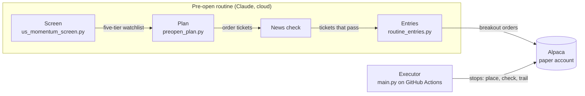

# AITradingBot

An automated US stock momentum trading system running on an Alpaca **paper** account. Every
weekday before the open, a scheduled AI routine runs a rules-based screen, builds an order plan,
checks recent news on each candidate and places the entries through the executor's own code. A
deterministic Python executor manages every stop. Everything runs in the cloud: the routines as
Claude Code cloud routines and the executor on GitHub Actions, with no local machine involved.

> **Disclaimer:** this is a personal engineering project. It trades simulated money only, has no
> proven edge, and nothing here is investment advice.

The engineering focus is on keeping an AI agent useful while making sure it cannot take risk: the AI
reads the news and can veto a trade, but position sizing, order limits and stop management are all
enforced in plain Python, and every order goes through one guarded code path.

---

## How it works



| Stage | When (US Eastern) | Component | What it does |
|---|---|---|---|
| Screen | Weekdays, 07:07 (08:07 in summer) | `us-momentum-routines/scripts/us_momentum_screen.py` | Scores about 580 stocks from the previous close and sorts them into five tiers |
| Plan | Right after the screen | `us-momentum-routines/scripts/preopen_plan.py` | Sets the market regime and turns top-tier stocks into order tickets |
| News check | Right after the plan | The AI routine | Removes any ticket with negative news from the last 3 days; it can never add a ticket or change a price |
| Entries | Before 09:10 | `scripts/routine_entries.py` → `engine/momentum.py` `enter()` | Places each ticket as a buy stop-limit day order, so it fills only on a breakout |
| Protection | Every 10 minutes while the market is open | `main.py protect` → `protect()` | Makes sure every position has a sell stop at the broker; enforces the daily loss halt |
| Trailing | 16:23 | `main.py eod` → `end_of_day()` | Raises each stop to just under the 10-session low |

The first four stages are one Claude Code cloud routine that runs on a fresh checkout of this
repository each weekday. It can place orders only by running `scripts/routine_entries.py`, which
calls the executor's own entry code and refuses to run against a non-paper account or after
09:10 ET. Nothing else places entries: if the routine fails, no entries are placed that day. A
second routine runs the screen on Saturdays as a weekly report and places nothing.

Nothing is stored between runs. The broker account is the only state: the executor reads positions
and orders from Alpaca on every run, and rebuilds a new position's stop from its filled entry order
(the trigger price and entry date give the plan's stop). The executor runs as a scheduled GitHub
Actions workflow ([`.github/workflows/executor.yml`](.github/workflows/executor.yml)). Because the
repository is public, its log shows only whether each job ran, skipped or failed.

---

## Strategy

Based on Mark Minervini's Trend Template and volatility contraction pattern (VCP), following
[Clement Ang's watchlist method](https://tradingresourcehub.substack.com/p/how-to-build-and-maintain-watchlists-clement-ang).
The full rules are in [`us-momentum-routines/docs/SPEC.md`](us-momentum-routines/docs/SPEC.md).

- **Universe:** S&P 500 plus a short extra list, using 14 months of daily bars from Yahoo Finance.
- **Trend Template:** seven checks, including price above the 50, 150 and 200-day averages, a rising
  200-day average, at least 30% above the 52-week low and within 25% of the 52-week high.
- **Relative strength:** a weighted 3, 6, 9 and 12-month return, ranked 1–99 within the universe;
  70 or more passes. This approximates, but is not, the IBD rating.
- **Tiers:** *Execution* (up to 5 stocks within 3% of a 20-day high, with a tight 10-day range and
  contracting price swings or drying-up volume),
  *Almost Ready*, *Secondary*, and long and short *Wide Lists* for monitoring.
- **Market regime:** *Defense* when SPY is below its 50-day average (no new orders), *Selective*
  when fewer than half the universe is above its own 50-day average (1 order a day), *Offense*
  otherwise (up to 3).
- **Order ticket:** trigger 0.1% above the 10-session high, limit 0.3% above the trigger, stop at the
  higher of the 10-session low and 8% below the trigger. Tickets with earnings within 3 days are
  skipped.

---

## Risk controls

All of these are enforced in code, not in prompts.

| Control | Rule |
|---|---|
| Risk per trade | 0.5% of equity between the trigger and the stop |
| Position size cap | 5% of equity |
| Order caps | The regime cap, and never more than 3 new orders a day |
| Daily loss halt | At -2% on the day: no new entries and unfilled entries are cancelled; stops stay in place |
| A stop on every position | A good-until-cancelled sell stop is held at the broker. A position found without one gets it on the next 10-minute check, or is closed if already below its stop |
| Stops only move up | Raised after each close to just under the 10-session low, never lowered |
| No duplicate orders | Each entry has a per-day, per-ticker `client_order_id`, so a retry or second run is rejected by the broker |
| Fresh data only | The screen and plan are rebuilt from the previous close every weekday; no entries from a screen older than 9 days, and entries only before the open |
| Paper trading | The executor trades a live account only when explicitly enabled; the AI routine's entry script refuses any non-paper account regardless |

Example: with $100,000 equity, a $100 trigger and a $94 stop, 0.5% risk allows 83 shares, but the
5% cap limits the position to 50 shares ($5,000).

---

## Lessons from the first version

The project started in June 2026 as a different design: an AI research bot that scored a fixed
watchlist each morning with Perplexity and traded intraday on those scores. It was retired in
October 2026. Its failures shaped the current design:

- **Test thresholds against the data you actually have.** A "volume at least 2x average" entry rule
  never passed, because the free IEX data feed sees only a small share of total market volume.
- **A rule that nothing is allowed to act on is not a control.** Scheduled checks flagged profit
  targets and exit signals that no component was permitted to execute.
- **Confirm that protective orders exist at the broker.** A stop order failed with an API error and
  was never retried; later, a position filled with no stop and stayed unprotected for a week. The
  executor now checks for a stop on every position every 5 minutes.
- **Treat the broker as the source of truth.** Local state files drifted from the real account, so
  the executor now reads positions and orders from Alpaca on every run.
- **Keep order placement deterministic.** A scheduled AI run that started after the open built its
  plan from partial-day prices, and the routines once stopped for several days without any alert.
  Entries are now allowed only before the open, and the routines run in the cloud instead of a
  desktop app on one PC.
- **Backtest before trusting a strategy.** A two-year mechanical backtest of the first version's
  rules (August 2024 to August 2026, without the AI research step) ended 0.9% down over 169 trades.
  See `scripts/backtest.py`.

---

## Results

Paper account, started with $100,000 in June 2026. Status as of 2026-10-28:

- **Account equity:** $100,502 (+0.5% since inception, across both versions).
- **Momentum system:** one open position. No new entries have been placed since the executor went
  live on 2026-10-20; the latest screen (2026-10-23) put the market in Defense, which allows none.
- **First version:** 13 closed trades by 2026-09-06, with a 30.8% win rate and a profit factor of 0.18.

These are far too few trades to judge either strategy, and they are reported as they are.

---

## Running it

Requirements: Python 3.10+ and an [Alpaca](https://alpaca.markets) paper trading account.

**On your own machine** (each step by hand, or from your own scheduler):

```
pip install -r requirements.txt
cp .env.example .env                       # add your Alpaca paper API keys

cd us-momentum-routines
python scripts/us_momentum_screen.py       # writes results/latest/
python scripts/preopen_plan.py             # writes plans/<date>.json and .md
cd ..
python scripts/routine_entries.py          # places today's entries (paper only, before 09:10 ET)

python main.py                             # the executor's stop jobs on a loop during market hours
```

**In the cloud** (the author's deployment):

- Executor: add `ALPACA_API_KEY` and `ALPACA_SECRET_KEY` (paper) as repository secrets under
  *Settings → Secrets and variables → Actions*. The workflow then runs on its schedule; it can also
  be started by hand from the *Actions* tab.
- Routines: two Claude Code cloud routines on this repository, in an environment with the same two
  keys as environment variables and network access to Yahoo Finance, Wikipedia and Alpaca. The
  weekday routine runs the commands above in order, with the news check between the plan and the
  entries. `python scripts/routine_entries.py --check` is a read-only test of the keys and account.

- **Settings:** order and sizing rules in `us-momentum-routines/config/risk.json`; risk percentages
  and caps in `config.py`.
- **Local state:** on your own machine, the executor writes its journal (`reasoning.md`) and trade
  log (`trade_log.md`) to `memory/`, which is not part of the repository. The cloud runs keep none.
- **Live trading:** off by default. It requires a `memory/strategy.md` containing
  `live_trading: true` and live Alpaca keys. It is not recommended.

---

## Project layout

```
.github/workflows/executor.yml The executor's schedule on GitHub Actions
main.py                         Executor jobs: protect, eod, or both on a loop (US Eastern time)
engine/momentum.py              Entries, stop protection, trailing stops, fill log
scripts/routine_entries.py      The only order path for the AI routine (paper only, before 09:10 ET)
scripts/backtest.py             Backtest of the first version's strategy
utils/alpaca_client.py          Alpaca REST API wrapper
config.py                       Risk constants
us-momentum-routines/
  scripts/                      Weekend screen and pre-open plan
  docs/SPEC.md                  Screening, regime and ticket rules
  config/                       risk.json, extra_tickers.txt

Retired first version, kept for reference:
engine/ (other modules), utils/perplexity_client.py, utils/email_client.py,
utils/github_sync.py, .claude/agents/, .claude/skills/
```

---

## Limitations

- Yahoo Finance data is unofficial and can change or rate-limit. The universe is mostly large caps.
- The relative strength rating is ranked only within the screened universe.
- Plans use the previous close, not pre-market prices.
- GitHub Actions schedules can start late or, at busy times, be skipped, so a new position can wait
  more than 10 minutes for its stop. Stops already placed are held by the broker and work without
  the executor.
- If the pre-open routine fails, no entries are placed that day; there is no fallback that would
  skip the news check.
- Paper fills are simulated and can be more favourable than real fills.
- The NYSE holiday list in `preopen_plan.py` covers 2026 only.
