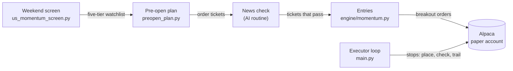

# AITradingBot

An automated US stock momentum trading system running on an Alpaca **paper** account. A rules-based
screen and a daily pre-open order plan run on a schedule, an AI routine checks recent news on each
candidate, and a deterministic Python executor places the orders and manages every stop.

> **Disclaimer:** this is a personal engineering project. It trades simulated money only, has no
> proven edge, and nothing here is investment advice.

The engineering focus is on keeping an AI agent useful while making sure it cannot take risk: the AI
reads the news and can veto a trade, but position sizing, order limits and stop management are all
enforced in plain Python, and every order goes through one guarded code path.

---

## How it works



| Stage | When (US Eastern) | Component | What it does |
|---|---|---|---|
| Screen | Saturday, after Friday's close | `us-momentum-routines/scripts/us_momentum_screen.py` | Scores about 580 stocks and sorts them into five tiers |
| Plan | Weekdays, about 08:00 | `us-momentum-routines/scripts/preopen_plan.py` | Refreshes prices, sets the market regime, turns top-tier stocks into order tickets |
| News check | Right after the plan | Scheduled Claude routine | Removes any ticket with negative news from the last 3 days; it can never add a ticket or change a price |
| Entries | Before 09:10 (routine) or 09:15–09:30 (executor) | `engine/momentum.py` `enter()` | Places each ticket as a buy stop-limit day order, so it fills only on a breakout |
| Protection | Every 5 minutes, 09:25–16:05, and at startup | `engine/momentum.py` `protect()` | Makes sure every position has a sell stop at the broker; enforces the daily loss halt |
| Trailing | 16:20 | `engine/momentum.py` `end_of_day()` | Raises each stop to just under the 10-session low and logs the day's fills |

The screen and plan are run by two scheduled Claude Code routines, which also write a decision
journal. The routine can place orders only by running `scripts/routine_entries.py`, which calls the
executor's own entry code and refuses to run against a non-paper account or after 09:10 ET. If the
routine does not run, the executor builds the day's plan itself (without the news check).

---

## Strategy

Based on Mark Minervini's Trend Template and volatility contraction pattern (VCP), following
[Clement Ang's watchlist method](https://tradingresourcehub.substack.com/p/how-to-build-and-maintain-watchlists-clement-ang).
The full rules are in [`us-momentum-routines/docs/SPEC.md`](us-momentum-routines/docs/SPEC.md).

- **Universe:** S&P 500 plus a short extra list, using 14 months of daily bars from Yahoo Finance.
- **Trend Template:** seven checks, including price above the 50, 150 and 200-day averages, a rising
  200-day average, at least 30% above the 52-week low and within 25% of the 52-week high.
- **Relative strength:** a weighted 3, 6, 9 and 12-month return, ranked 1–99 within the universe;
  70 or more passes. This approximates, but is not, the IBD rating.
- **Tiers:** *Execution* (up to 5 stocks within 3% of a 20-day high, with a tight 10-day range and
  contracting price swings or drying-up volume),
  *Almost Ready*, *Secondary*, and long and short *Wide Lists* for monitoring.
- **Market regime:** *Defense* when SPY is below its 50-day average (no new orders), *Selective*
  when fewer than half the universe is above its own 50-day average (1 order a day), *Offense*
  otherwise (up to 3).
- **Order ticket:** trigger 0.1% above the 10-session high, limit 0.3% above the trigger, stop at the
  higher of the 10-session low and 8% below the trigger. Tickets with earnings within 3 days are
  skipped.

---

## Risk controls

All of these are enforced in code, not in prompts.

| Control | Rule |
|---|---|
| Risk per trade | 0.5% of equity between the trigger and the stop |
| Position size cap | 5% of equity |
| Order caps | The regime cap, and never more than 3 new orders a day |
| Daily loss halt | At -2% on the day: no new entries and unfilled entries are cancelled; stops stay in place |
| A stop on every position | A good-until-cancelled sell stop is held at the broker. A position found without one gets it within 5 minutes, or is closed if already below its stop |
| Stops only move up | Raised after each close to just under the 10-session low, never lowered |
| No duplicate orders | Each entry has a per-day, per-ticker `client_order_id`, so a retry or second run is rejected by the broker |
| Fresh data only | No entries from a screen older than 9 days, and entries only before the open |
| Paper trading | The executor trades a live account only when explicitly enabled; the AI routine's entry script refuses any non-paper account regardless |

Example: with $100,000 equity, a $100 trigger and a $94 stop, 0.5% risk allows 83 shares, but the
5% cap limits the position to 50 shares ($5,000).

---

## Lessons from the first version

The project started in June 2026 as a different design: an AI research bot that scored a fixed
watchlist each morning with Perplexity and traded intraday on those scores. It was retired in
October 2026. Its failures shaped the current design:

- **Test thresholds against the data you actually have.** A "volume at least 2x average" entry rule
  never passed, because the free IEX data feed sees only a small share of total market volume.
- **A rule that nothing is allowed to act on is not a control.** Scheduled checks flagged profit
  targets and exit signals that no component was permitted to execute.
- **Confirm that protective orders exist at the broker.** A stop order failed with an API error and
  was never retried; later, a position filled with no stop and stayed unprotected for a week. The
  executor now checks for a stop on every position every 5 minutes.
- **Treat the broker as the source of truth.** Local state files drifted from the real account, so
  the executor now reads positions and orders from Alpaca on every run.
- **Keep order placement deterministic.** A scheduled AI run that started after the open built its
  plan from partial-day prices, and the routines once stopped for several days without any alert.
  Entries are now allowed only before the open, and the executor builds the plan itself if the
  routine has not.
- **Backtest before trusting a strategy.** A two-year mechanical backtest of the first version's
  rules (August 2024 to August 2026, without the AI research step) ended 0.9% down over 169 trades.
  See `scripts/backtest.py`.

---

## Results

Paper account, started with $100,000 in June 2026. Status as of 2026-10-28:

- **Account equity:** $100,502 (+0.5% since inception, across both versions).
- **Momentum system:** one open position. No new entries have been placed since the executor went
  live on 2026-10-20; the latest screen (2026-10-23) put the market in Defense, which allows none.
- **First version:** 13 closed trades by 2026-09-06, with a 30.8% win rate and a profit factor of 0.18.

These are far too few trades to judge either strategy, and they are reported as they are.

---

## Running it

Requirements: Python 3.10+ and an [Alpaca](https://alpaca.markets) paper trading account. The
author's deployment runs on Windows (`run_bot.bat` is a launcher for Windows Task Scheduler), but
the Python code is cross-platform.

```
pip install -r requirements.txt
cp .env.example .env                  # add your Alpaca paper API keys

cd us-momentum-routines
python scripts/us_momentum_screen.py  # weekly: writes results/latest/
python scripts/preopen_plan.py        # optional: the executor builds the plan itself if missing
cd ..

python main.py                        # the executor; keep it running during US market hours
```

- **Settings:** order and sizing rules in `us-momentum-routines/config/risk.json`; risk percentages
  and caps in `config.py`.
- **Local state:** the executor writes its journal (`reasoning.md`) and trade log (`trade_log.md`)
  to `memory/`, which is created on first run and is not part of the repository.
- **Live trading:** off by default. It requires a `memory/strategy.md` containing
  `live_trading: true` and live Alpaca keys. It is not recommended.

---

## Project layout

```
main.py                         Executor scheduler (US Eastern time)
engine/momentum.py              Entries, stop protection, trailing stops, fill log
scripts/routine_entries.py      The only order path for the AI routine (paper only, before 09:10 ET)
scripts/backtest.py             Backtest of the first version's strategy
utils/alpaca_client.py          Alpaca REST API wrapper
config.py                       Risk constants
us-momentum-routines/
  scripts/                      Weekend screen and pre-open plan
  docs/SPEC.md                  Screening, regime and ticket rules
  config/                       risk.json, extra_tickers.txt

Retired first version, kept for reference:
engine/ (other modules), utils/perplexity_client.py, utils/email_client.py,
utils/github_sync.py, .claude/agents/, .claude/skills/
```

---

## Limitations

- Yahoo Finance data is unofficial and can change or rate-limit. The universe is mostly large caps.
- The relative strength rating is ranked only within the screened universe.
- Plans use the previous close, not pre-market prices.
- The executor must be running during market hours for entries and stop trailing. Stops already
  placed are held by the broker and work without it.
- Paper fills are simulated and can be more favourable than real fills.
- The NYSE holiday list in `preopen_plan.py` covers 2026 only.
